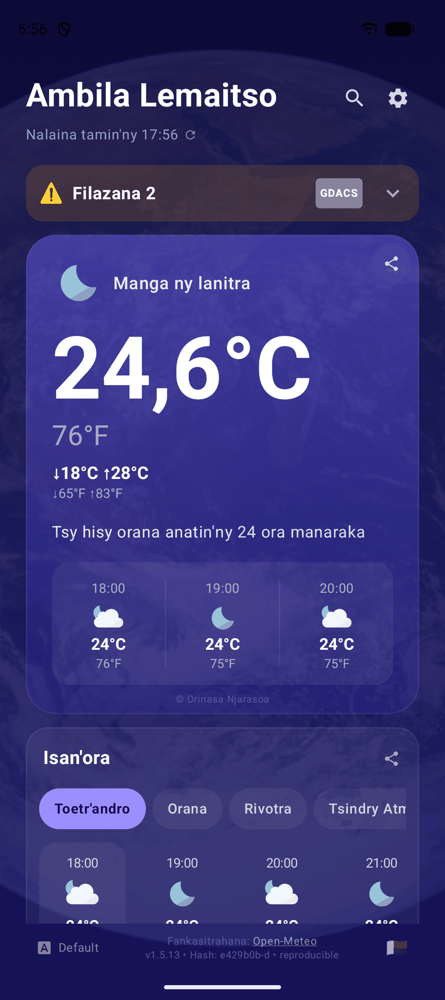
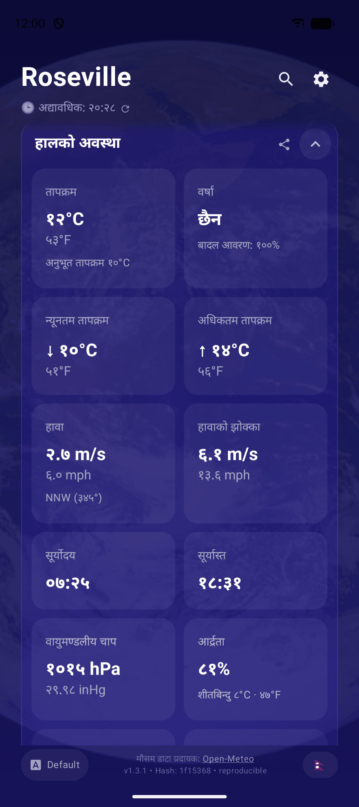
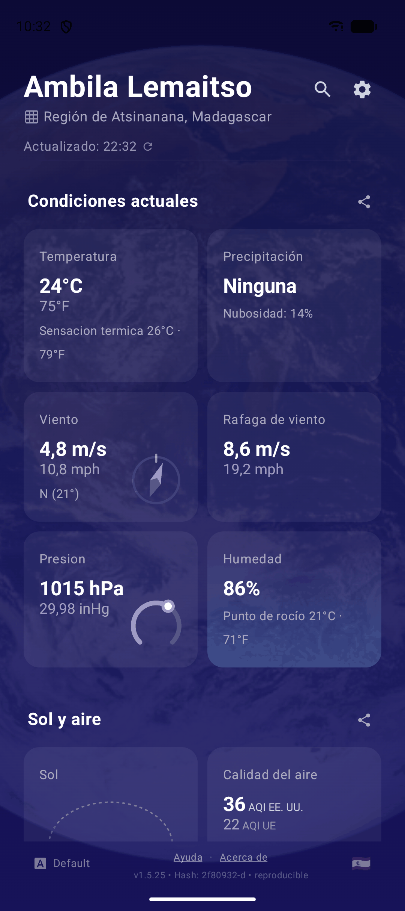
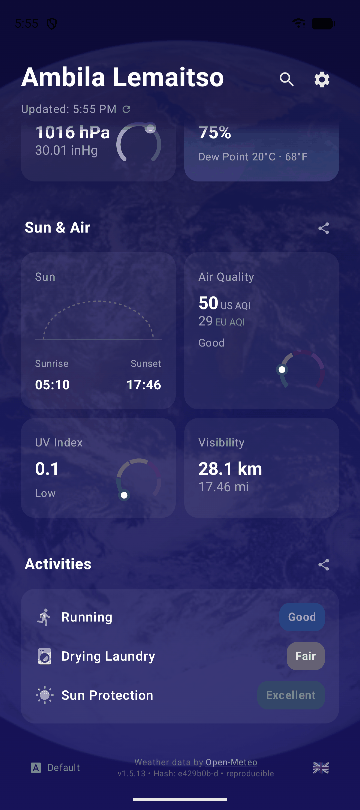

# maripànaTokana

**maripànaTokana** (Malagasy for "a single thermometer") is a weather app for Android, and a [web app](./web) with the same features. A hosted copy of the web app is at **[maripana.njarasoa.org](https://maripana.njarasoa.org)**, with no install needed. Every value shows in metric and imperial units side by side. The app has 8 languages and 22 font choices.

<p align="center">
  
  
  
  
</p>

## Features

Android and the web app have the same features. Only the widgets and the geocoder choice are Android only.

**Weather**
- **Main card**: the condition, the temperature (°C with 1 decimal, °F as a whole number), today's low and high, and 4 hour tiles (now, +4, +8 and +12 hours). A line tells when rain or snow starts or stops in the next 24 hours. Air quality (US and EU index) shows when it is not good. For a place in another time zone, the hour tiles also show the phone's time.
- **One scrolling column**: below the main card, all cards are always open:
  - **Hourly and 10-day forecasts** with the same tabs: Conditions, Precipitation, Wind, Pressure, UV Index and Air Quality (when there is data). Each tab has a row of cards and a chart.
  - **Minutely nowcast** in the hourly card, for the next 2 hours, when rain or snow falls or is coming (Open-Meteo only).
  - **Current conditions**: temperature with feels-like, precipitation with cloud cover, wind with compass, gusts, pressure gauge, and humidity with dew point.
  - **Sun & Air**: sun arc, air-quality gauge, UV dial and visibility. Tap the air-quality gauge to see each pollutant and, in Europe, 6 pollen types.
  - **Activities**: ratings for running, drying laundry and sun protection.
- **Weather alerts** from 7 sources: NWS (US), NHC (hurricanes), MeteoAlarm (Europe), JMA (Japan), ECCC (Canada), BOM (Australia) and GDACS (global). GDACS is used only where no regional source covers the place.
- **Weather data** from [Open-Meteo](https://open-meteo.com) (default, no key) or [Pirate Weather](https://pirateweather.net) (your own API key).
- **Offline**: the app keeps the last forecast for each place and shows it when there is no connection.

**Places**
- **Search** by city, postal code, coordinates (decimal or degrees, minutes and seconds), Plus Code or map link. A searched place shows for 12 hours, then the app goes back to your location.
- **Favorites**: tap the heart to save a searched place. Hold the name to rename it, and tap the full heart to remove it. Swipe, or tap the arrows, to move between places. Hold an arrow to pick a place from a list. The pin goes back to your location.
- **Header**: the place, then the region and country. For a place in another time zone, a chip shows its local time. Place names in other scripts can also show in Latin letters.
- **Location details**: the grid icon opens a card with the place, the coordinates and the full Plus Code. Tap a line to open a map, and hold a line to copy it.
- **Shared places**: share a map link, a `geo:` link or coordinates to the Android app. The web app takes them as `?q=` or from the system share menu.

**Display**
- **Units**: every value shows metric and imperial units. Tap a value to put the other unit first.
- **8 languages**: Malagasy, Arabic, English, Spanish, French, Hindi, Nepali and Chinese. Tap the flag in the footer to change. Local digits for Arabic, Hindi and Nepali, a decimal comma where the language uses one, and right-to-left layout for Arabic. The permission and error screens also show the system language, when it is different.
- **22 font choices**: the default font and 21 font pairs. Tap the font name in the footer to change.
- **Share**: each card has a share button that shares the card as an image, with the date and time but no location data.
- **Help and About pages**: 11 questions and answers; the data sources, fonts, libraries and licenses; and what the system reports about the device.
- **Refresh**: pull down, or tap the update time. The app also refreshes when you come back to it and the data is more than 30 minutes old.
- **Two home-screen widgets** (Android): 4x1 (current weather) and 4x2 (current weather, feels-like, humidity, wind and the next 3 days). They refresh every 30 minutes.
- **Install on iPhone and iPad** (web): an Install link in the footer shows how to add the web app to the Home Screen.
- **Advanced Mode** (Settings): shows the weather-source choice, a switch for each alert source, the geocoder choice (Android), and which alert sources failed.
- Blue Marble background, edge to edge.

## Get the App

**F-Droid**: the free and open-source Android app repository. F-Droid builds each release itself, so a new version can take some days to appear.

[](https://f-droid.org/packages/orinasa.njarasoa.maripanatokana/)

**Obtainium**: get each release as soon as it is on GitHub, without the F-Droid build delay.

[](https://apps.obtainium.imranr.dev/redirect?r=obtainium://add/https://github.com/mpilasy/maripanaTokana)

**Web**: open [maripana.njarasoa.org](https://maripana.njarasoa.org) in any browser. You can also add it to the home screen.

Each [GitHub release](https://github.com/mpilasy/maripanaTokana/releases) has two APKs, and Obtainium asks which one to install:
- **F-Droid** (`maripanaTokana-vX.apk`): uses the Android `LocationManager`, with no Google Play Services. Its default geocoder is Nominatim. This is the APK that F-Droid publishes.
- **Standard** (`maripanaTokana-standard-vX.apk`): uses Google Play Services for location. Its default geocoder is the system geocoder.

Both APKs have the same app ID and signing key, so a phone can have only one of them. To change, install the other APK over the current one.

The Android app is made for phones with a touchscreen, Android 7.0 or later.

## Build and Run

You need JDK 21. The app uses Gradle 9.4.1 through the wrapper.

```bash
# F-Droid flavor (no Google Play Services)
./gradlew assembleFdroidDebug
./gradlew assembleFdroidRelease

# Standard flavor (with Google Play Services)
./gradlew assembleStandardDebug
./gradlew assembleStandardRelease

# Unit tests
./gradlew testFdroidDebugUnitTest testStandardDebugUnitTest
```

Release builds are signed only when `keystore.properties` exists or the `KEYSTORE_FILE`, `KEYSTORE_PASSWORD`, `KEY_ALIAS` and `KEY_PASSWORD` environment variables are set. Otherwise the release APK is unsigned.

To build and run the web app, see [web/README.md](web/README.md).

For the F-Droid build rules and the release process, see [docs/FDROID.md](docs/FDROID.md).

## Translations

All texts for both platforms are in `shared/i18n/locales/{ar,en,es,fr,hi,mg,ne,zh}.json`. Keys under `android_only` or `web_only` are used by one platform only. After a change:

```bash
node shared/i18n/generate-android-strings.js   # writes app/src/main/res/values*/strings.xml
node scripts/check_i18n_parity.js              # every language must have the same keys
```

Do not edit the Android `strings.xml` files directly.

## Project Structure

```
app/            Android app (Kotlin, Jetpack Compose)
web/            Web app (SvelteKit), see web/README.md
shared/i18n/    Texts for both platforms
metadata/       Local copy of the F-Droid metadata
fastlane/       Store texts, changelogs and screenshots for 8 languages
scripts/        Build, release, test and screenshot scripts
docs/           Design, F-Droid, testing and screenshot guides
```

The Android app uses MVVM with Clean Architecture. Package: `orinasa.njarasoa.maripanatokana`

```
app/src/main/java/orinasa/njarasoa/maripanatokana/
├── data/
│   ├── location/        # Location provider, coordinate and Plus Code parsing, place names, shared links
│   ├── remote/          # Retrofit services and DTOs: weather, air quality, geocoding and the 7 alert sources
│   ├── repository/      # Repository implementations, weather cache
│   ├── settings/        # AppSettingsRepository
│   └── source/          # Weather sources (Open-Meteo, Pirate Weather) and geocoders
├── di/                  # Hilt modules (Network, Repository, CommonLocation)
├── domain/
│   ├── model/           # Value classes (Temperature, Pressure, WindSpeed, ...), alerts, air quality, saved places
│   └── repository/      # Repository interfaces
├── ui/
│   ├── permission/      # PermissionHandler interface (each flavor has its own implementation)
│   ├── settings/        # Settings, Help and About screens, device info
│   ├── theme/           # Compose theme, fonts, CompositionLocals
│   └── weather/         # WeatherScreen, WeatherViewModel, WeatherUiState, permission and error screens
│       └── components/  # Charts, tiles, dials, alert banner, nowcast, dialogs
├── util/                # Logging
└── widget/              # Glance widgets (4x1, 4x2), WorkManager updater
    └── theme/           # Widget Glance theme
```

Code that is different for each flavor is in `app/src/fdroid/` and `app/src/standard/`: the location provider, the permission handler, the widget fetcher and the default settings.

## Technical Stack

| Component | Version |
|-----------|---------|
| AGP | 9.2.1 |
| Gradle | 9.4.1 |
| Kotlin | 2.2.21 |
| KSP | 2.3.12 |
| Compose BOM | 2026.06.01 |
| Glance | 1.2.0 |
| Hilt | 2.60.1 |
| Retrofit | 2.11.0 |
| OkHttp | 4.12.0 |
| Kotlinx Serialization | 1.7.3 |
| Play Services Location (Standard flavor) | 21.4.0 |
| WorkManager | 2.12.0 |
| JDK toolchain | 21 |
| Min SDK | 24 (Android 7.0) |
| Compile and target SDK | 36 |

## Permissions

- `INTERNET`: get the weather data, air quality, place names and alerts.
- `ACCESS_FINE_LOCATION`: precise location.
- `ACCESS_COARSE_LOCATION`: approximate location, if you do not allow precise location.

The app asks for location access at run time. The permission screen shows the app language and, when it is different, the system language. Without location access, you can still search for places and save them.

WorkManager adds the permissions it needs to refresh the widgets: `WAKE_LOCK`, `ACCESS_NETWORK_STATE`, `RECEIVE_BOOT_COMPLETED` and `FOREGROUND_SERVICE`.

## Documentation

- [CHANGELOG.md](CHANGELOG.md): the changes in each version.
- [docs/DESIGN.md](docs/DESIGN.md): the design of the Android app.
- [docs/FDROID.md](docs/FDROID.md): F-Droid build rules and the release process.
- [docs/TESTING_GUIDE.md](docs/TESTING_GUIDE.md): how to test the Android app.
- [docs/SCREENSHOTS_README.md](docs/SCREENSHOTS_README.md): how to take the store screenshots.
- [web/README.md](web/README.md), [web/docs/DESIGN.md](web/docs/DESIGN.md) and [web/docs/TESTING.md](web/docs/TESTING.md): the web app.

## License

(c) Orinasa Njarasoa

This program is free software: you can redistribute it and/or modify it under the terms of the GNU General Public License as published by the Free Software Foundation, either version 3 of the License, or (at your option) any later version. See [LICENSE](LICENSE).

Versions up to and including 1.5.24 were released under the MIT License.
